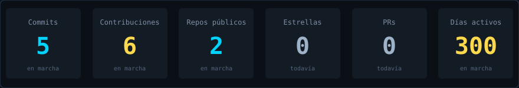
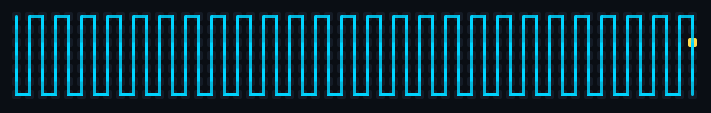

<div align="center">
  
</div>

## Juan Talavera · `JuanTS`

Monto laboratorios de IA en casa: tres máquinas, modelos locales, voz propia y un panel de control que se reinicia cuando le apetece. Nada de humo: si algo funciona, se ve; si no, se ve el error en el panel.

```text
Modelos locales .... Qwen3.8-Flash-Next (Strata), llama.cpp, Ollama
Voz ................ Whisper (STT) + Piper (TTS), castellano peninsular
Filosofía .......... lo local primero; la nube es para quienes dudan
```

### 🧪 El laboratorio

```
     [Líder · Lenovo]  ⇄  [Implementador · Ubuntu]  ⇄  [Revisor · portátil]
      Hermes + voz         modelos pesados, RAG,         pruebas, VSCode,
      panel de control     finetuning                    OpenCode
```

Unidas por Tailscale. El firewall las separa con entusiasmo, como debe ser.

### 🛠️ Stack


### 📊 Actividad, sin mentir






### 🗂️ Proyectos

| Proyecto | Qué es | Estado |
|---|---|---|
| [EmprendIA](https://github.com/JuanTS/emprendeia-fp) | Fase 0: IA para convertir proyectos de FP de Castilla-La Mancha en autoempleo | En marcha |
| AI Lab Panel | Panel cyberpunk de rendimiento del laboratorio: modelos, VRAM/RAM, latencia y tok/s en vivo | Privado, con razón |

### 📬 Contacto

Por aquí. Y si es urgente, ya sabes dónde encontrarme.

---

*Si estás leyendo esto, ya eres la contribución más importante del mes.*
